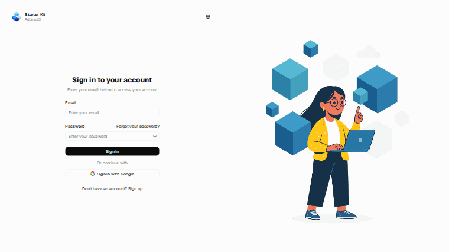

<div align="center">

# AdonisJS Starter Kit

**Full-stack AdonisJS 7 + Inertia/React monorepo with auth, RBAC, audit trail, i18n, realtime notifications and durable jobs already wired.**

[](https://github.com/filipebraida/adonisjs-starter-kit/actions/workflows/ci.yml)
[](LICENSE)




</div>

I use this kit to prototype projects with coding agents, and my students use it for their capstone projects. Clone it and auth, UI, i18n, RBAC, layouts, tests and CI already work, so you go straight to the interesting part. A piece you don't need comes off by deleting it, not by refactoring.

## Features

- **Auth**: sign-up, password reset, Google sign-in, API tokens and admin impersonation.
- **RBAC** with [`@adonis-agora/authz`](https://github.com/DavideCarvalho/adonis-agora-authz): typed capabilities, roles in code plus institutional roles built on a roles page, enforced by policies.
- **Audit trail** with [`@filipebraida/adonis-auditing`](https://github.com/filipebraida/adonis-auditing): who did what, when and from where, on an Activity page.
- **Durable jobs** with [`@adonis-agora/durable`](https://github.com/DavideCarvalho/adonis-agora-durable): mails and notifications run as retryable workflows on Postgres, with no Redis.
- **Realtime notifications** over SSE, with a bell and an unread badge.
- **i18n** in English and Portuguese, with typed keys shared by the server and the frontend.
- **UI** built on shadcn/ui and Tailwind 4, with four layout shells, modals and a dark mode.
- **Tests and CI**: Japa specs on a real Postgres, coverage, and a lint ruleset that enforces the conventions.
- **Agent-ready**: [`AGENTS.md`](AGENTS.md) and [skills](packages/skills) for Claude Code, OpenCode and Cursor.
- **Deploy** to one server with [Catapult](https://github.com/catapultjs/deploy) and PM2.

## Quick start

You need Node.js 24+, pnpm and Docker.

```bash
pnpm create adonisjs@latest -K="filipebraida/adonisjs-starter-kit"
cd <your-app>

cp apps/web/.env.example apps/web/.env
pnpm ace generate:key
pnpm infra:up            # Postgres, Mailpit, pgAdmin
pnpm ace migration:run
pnpm ace db:seed         # admin@repo.com / 123
pnpm dev                 # http://localhost:3333
```

Run `pnpm test`, `pnpm typecheck` and `pnpm lint` before you push. To deploy, run `pnpm deploy:setup` once per server, then `pnpm deploy:ship` (see `deploy.ts`).

## Learn more

- [`AGENTS.md`](AGENTS.md) covers the architecture, module rules, commands and conventions.
- [`packages/skills`](packages/skills) holds a step-by-step guide for each task: CRUD, auth, mail, i18n, testing and more.

## Credits

Inspired by [shadcn/ui](https://ui.shadcn.com/), [Batosai's AdonisJS starter](https://github.com/batosai/adonis-starter-kit), [shadcn Admin](https://github.com/satnaing/shadcn-admin) and the [Laravel React Starter Kit](https://github.com/laravel/react-starter-kit). Thanks to [Sayed Ahmed](https://github.com/sayeed205), [Lupiac](https://github.com/Lupiac) and [Corentin Clichy](https://github.com/corentinclichy). Contributions are welcome.

[MIT](LICENSE)
