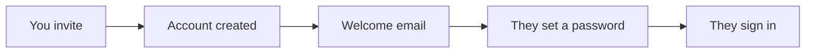

The **Users** screen, under Administration, lists every account in the app.

## Finding someone

Type part of a name or an email in **Search...**: the list updates as you type. The **Role** filter shows only people with the roles you tick. **Clear filters** brings the whole list back. Click a column's title to sort by it.

## Adding or inviting

**Add** creates the account at once: you type the name and email, pick the role and, if you want, a password. **Invite** only asks for the email and the role: the person picks their own password.

An invitation goes this way:

Giving a role above **User** takes being able to manage roles.

## Editing, deleting and impersonating

The **…** menu at the end of each row only shows what you may do with that account:

- **Edit** changes the name, email, role or password.
- **Impersonate** opens the app as that person, to see what they see. A banner at the top says whom you are signed in as, and **Return as** takes you back to your account.
- **View activity** opens the log filtered by that person.
- **Delete** removes the account. To confirm, you type its email.

> [!WARNING]
> Deleting cannot be undone. If the person just should not sign in any more, consider taking their role away instead of deleting the account.

Nobody deletes their own account, and a manager only adds and invites.
