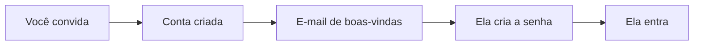

A tela **Usuários**, em Administração, lista todas as contas do app.

## Achar alguém

Escreva parte do nome ou do e-mail em **Pesquisar...**: a lista se atualiza enquanto você digita. O filtro **Papel** mostra só quem tem os papéis marcados. **Limpar filtros** volta a lista inteira. Clique no título de uma coluna para ordenar por ela.

## Adicionar ou convidar

**Adicionar** cria a conta na hora: você escreve o nome, o e-mail, escolhe o papel e, se quiser, uma senha. **Convidar** só pede o e-mail e o papel: a própria pessoa escolhe a senha.

O convite segue este caminho:

Dar um papel acima de **Usuário** exige poder gerenciar papéis.

## Editar, excluir e entrar como

O menu **…** no fim de cada linha mostra só o que você pode fazer com aquela conta:

- **Editar** muda o nome, o e-mail, o papel ou a senha.
- **Entrar como** abre o app como aquela pessoa, para ver o que ela vê. Uma faixa no topo avisa com quem você está, e **Voltar como** retorna à sua conta.
- **Ver atividade** abre o registro filtrado por aquela pessoa.
- **Excluir** apaga a conta. Para confirmar, você escreve o e-mail dela.

> [!WARNING]
> Excluir não tem volta. Se a pessoa só não deve mais entrar, considere tirar o papel dela em vez de excluir a conta.

Ninguém exclui a própria conta, e quem é gerente só adiciona e convida.
